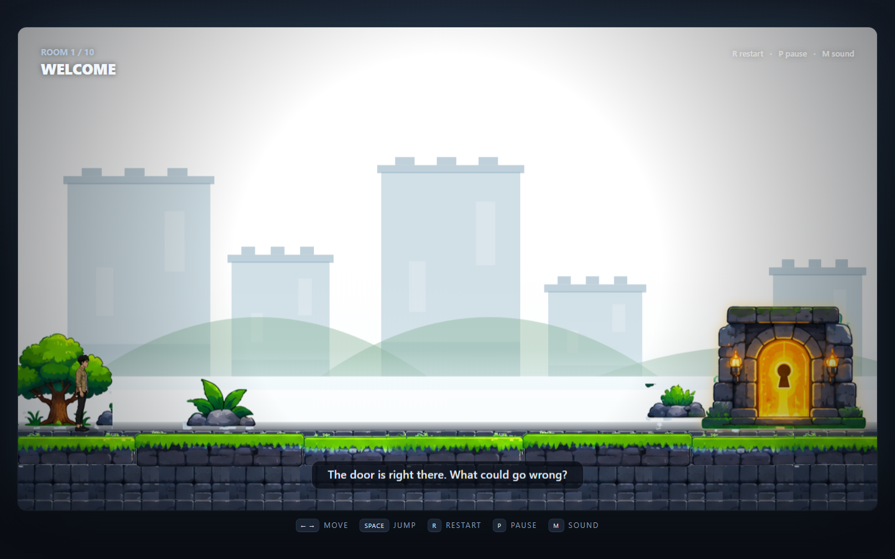

# Trap Game — Every Door Lies

A hand-drawn troll platformer in the spirit of *Level Devil*: ten single-screen
rooms, one door each, and a level that actively lies to you. The floor drops away,
spikes fall from the ceiling, walls slam shut, and sometimes the door moves.

Built with TypeScript and a hand-rolled Canvas 2D engine. No runtime dependencies.



## Play

```shell
npm install
npm run dev      # http://localhost:5173
```

```shell
npm run build    # type-check + production bundle in dist/
npm run preview  # serve the production build
```

## Controls

| Action  | Keys                        |
| ------- | --------------------------- |
| Move    | `←` `→` or `A` `D`          |
| Jump    | `Space`, `W`, `↑` or `Z`    |
| Restart | `R`                         |
| Pause   | `P` or `Esc`                |
| Sound   | `M`                         |

Touch devices get on-screen thumb buttons. Progress and best death counts are
stored in `localStorage`.

## How it plays

Every room is one screen: you spawn on the left, the door waits on the right, and
the traps are invisible until you commit. Touching anything is instant death, and
death restarts the room in under a second, so the loop stays tight. Ten rooms ramp
from a single collapsing floor to a gauntlet of drop-spikes, a sweeping saw, a
crushing slab and a floor that gives way mid-jump.

Rooms are data, not code — see `src/game/rooms.ts`:

```ts
{
  kind: "floorFall",
  x: 560, w: 200,
  triggerX: 470,        // fires once the player's centre passes this
  delay: 0.06,
  taunt: "The floor was a suggestion.",
}
```

Trap kinds: `floorFall`, `spikesDrop`, `spikesPop`, `crusher`, `saw`, `wall`,
`doorShift`, `fakeDoor`. Each runs its own small state machine in
`src/game/traps.ts` and reports a damage volume while it is dangerous.

## Art pipeline

All visuals come from the two SVG sheets in the repo root
(`trap_game_player_sprite_sheet.svg`, `trap_adventure_environment.svg`). Both are
base64 PNGs wrapped in `<svg><image>`, so `tools/extract_assets.py` unpacks them,
slices the player contact sheet into an animation atlas, cuts the environment kit
into sprites, removes the baked checkerboard, and packs everything into two
atlases:

```shell
python3 tools/extract_assets.py   # needs Pillow, numpy, scipy
```

Output lands in `public/assets/` (`player-atlas.png`, `kit-atlas.png`,
`ledge-tile.png`, `manifest.json`), with review copies and a contact sheet in
`docs/asset-preview/`.

## Layout

```
src/core/      asset loading, input, audio synthesis, save data
src/render/    parallax backdrop, platform painter
src/game/      rooms, traps, player physics, particles, HUD, game loop
tools/         asset extraction
docs/          generated asset previews and screenshots
```

Audio is synthesised with WebAudio at runtime — there are no sound files.

## Licence

Art © the repository owner. Code under the repository's existing licence.
